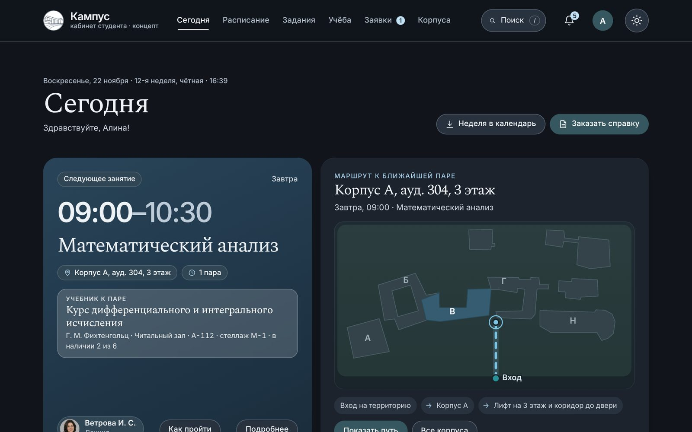
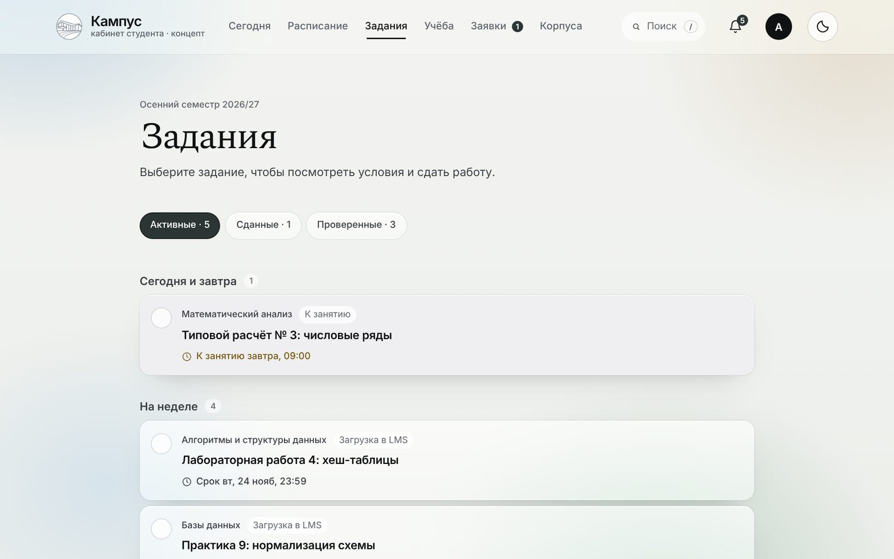
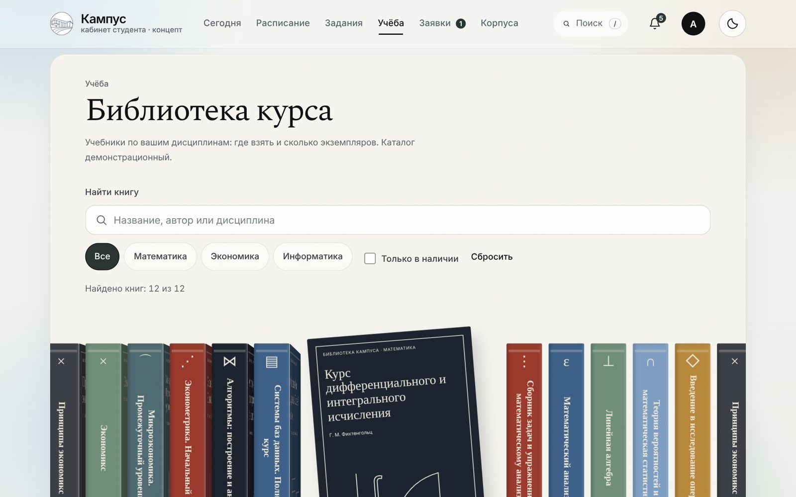
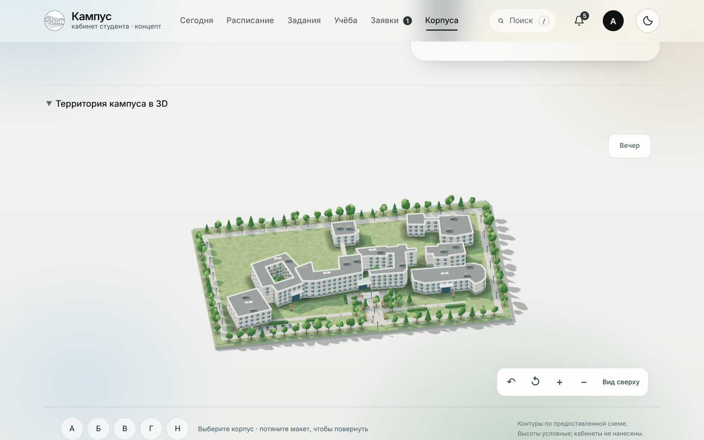
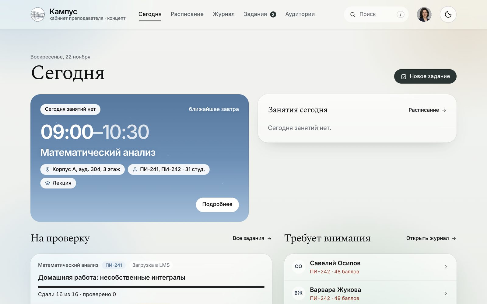
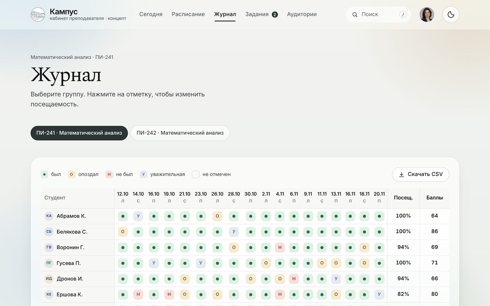
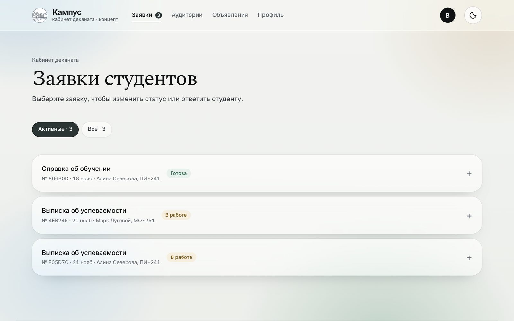
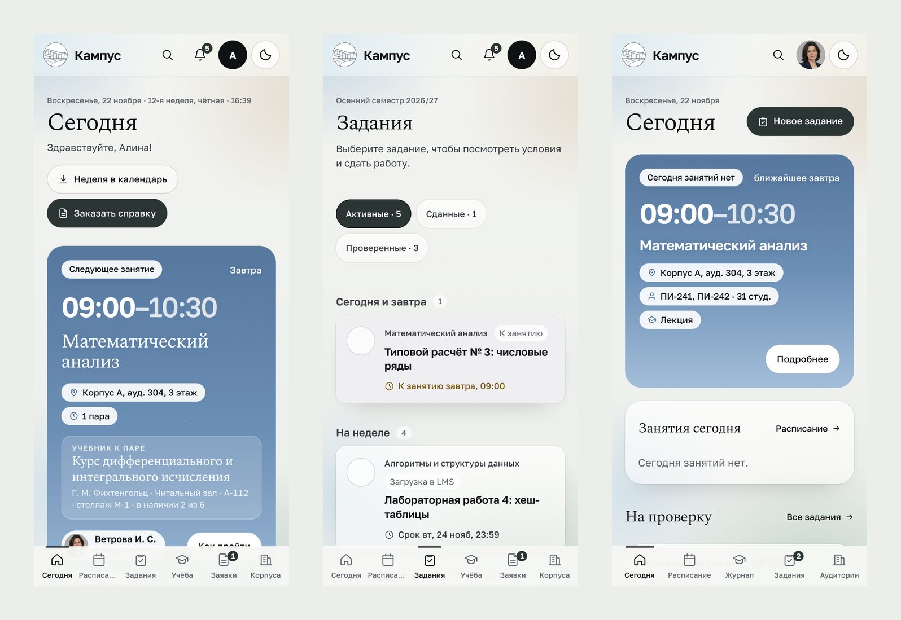

<p align="center"></p>

<h1 align="center">Кампус</h1>
<p align="center"><b>Один кабинет для всей учёбы — студенту, преподавателю и деканату</b><br>
Концепт-прототип для MGIMO×AI Challenge, номинация «Вайб-кодинг». Не официальный сервис университета; все люди и данные вымышлены.</p>

<p align="center"><a href="https://mgimo-miem-hero.github.io/student-ai-campus/"><b>Открыть демо → mgimo-miem-hero.github.io/student-ai-campus</b></a><br>
Вход в один клик по карточке демо-аккаунта, пароль <code>Campus-demo-2026</code>.</p>


Кампус — личный кабинет университета. Три кабинета связаны между собой: преподаватель выдал задание — оно уже у студента; студент сдал — преподаватель видит сдачу; студент заказал справку — деканат меняет статус, и студент видит его вместе с электронным документом и QR-проверкой.

## Две версии

| | Демо на GitHub Pages | Полная версия (`python3 server.py`) |
| --- | --- | --- |
| Где | [ссылка выше](https://mgimo-miem-hero.github.io/student-ai-campus/), без установки | Любой компьютер с Python 3.11+, пакеты не нужны |
| Данные | Кабинеты посчитаны настоящим сервером при сборке, пересобираются каждую ночь | SQLite на сервере |
| Вход | PBKDF2-хеш пароля проверяется в браузере (WebCrypto) | scrypt-хеши с солью в базе, cookie-сессия HttpOnly, лимит попыток |
| Что сохраняется | Заявки и их статусы, прочтение уведомлений, отметки «Сдано», объявления — только в вашем браузере | Всё, включая журнал, оценки, переносы занятий, консультации, занятость аудиторий |
| Изоляция данных | Нет: статический сайт отдаёт данные всех демо-аккаунтов | Каждый видит только своё, чужая заявка — 404, чужой раздел — 403 |

Требования конкурса к безопасности (свои данные у каждого пользователя, хеши паролей, ключи только на сервере) выполняет полная версия; демо на Pages — витрина интерфейса на вымышленных данных.

## Студент


«Сегодня»: ближайшая пара с аудиторией, преподавателем и учебником к ней, карта маршрута от входа на территорию до корпуса, расписание дня, быстрые переходы (новости, студенческий билет, справка, помощник), полка учебников с поиском, новости и преподаватели. Уведомления — под колокольчиком.



Светлая и тёмная тема переключаются кнопкой в шапке и запоминаются.



Задания сгруппированы «Просрочено / Сегодня и завтра / На неделе / Позже». Сдача — кружком или со ссылкой на работу; баллы и комментарий преподавателя приходят сюда же.



«Библиотека курса»: объёмная полка учебников по матанализу, линейной алгебре, вероятностям, экономике, эконометрике и информатике. Выбранная книга выдвигается обложкой; полку листают стрелками, колёсиком или перетаскиванием, поиск работает по названию, автору и дисциплине. Обложки нарисованы кодом, наличие и стеллажи демонстрационные.


«Корпуса»: свободные аудитории на выбранную пару, 3D-корпус и проектный план этажа с коридорами, дверями, лестницей и лифтом. Маршрут к аудитории идёт от входа через лифт до двери, коридоры главного корпуса названы как улицы. Кнопка «Ближайшая свободная аудитория» найдёт, где подготовиться между парами.



Объёмная модель территории на three.js: корпуса, газоны, аллеи, фонари. Модель вращается, приближается и облетает и не обрезается при любом повороте. Для выбранной пары на ней подсвечивается путь от входа до двери корпуса. Кнопка «Вечер» включает закатное освещение с окнами и фонарями.

Ещё: электронный студенческий билет с QR (наклоняется за курсором и переворачивается), шкалы баллов с порогами 60/75/90, запись на консультацию, заказ справок с историей статусов, справочный помощник по расписанию, заданиям и документам, режим презентации для жюри (10 слайдов), страница «Такой аудитории нет» для неверных адресов.

## Преподаватель и деканат

| Преподаватель | Журнал |
| --- | --- |
|  |  |
| Ближайшее занятие, работы на проверку, зона риска, консультации | «Студенты × занятия»: отметка кликом, итоги, выгрузка в Excel |



Деканат ведёт очередь заявок («Принята» → «В работе» → «Готова» → «Выдана» или «Отклонена») с комментарием на каждом шаге, публикует объявления всем или одной группе и отмечает занятость аудиторий на пару или день.

## С телефона



Те же страницы и данные от 320 px: нижняя навигация, крупные области нажатия, учёт экранной клавиатуры и безопасных зон. 3D-сцены на телефоне получают облегчённый режим (меньше пикселей и деталей) и создаются только при прокрутке к ним.

## Демо-аккаунты

| Логин | Кто | Что посмотреть |
| --- | --- | --- |
| `alina` | Студентка, ПИ-241 | Сегодня, задания, консультации, справки, билет |
| `mark` | Студент, МО-251 | Другие дисциплины, задолженность, нет допуска |
| `vetrova` | Преподаватель, матанализ в ПИ-241 и ПИ-242 | Журнал, посещаемость, проверка, изменение занятия |
| `dekanat` | Сотрудник деканата | Заявки, справки с QR, объявления, занятость аудиторий |

Пароль всех демо-аккаунтов — `Campus-demo-2026` (общедоступные тестовые аккаунты).

## Запуск

```sh
python3 server.py
```

Откройте http://127.0.0.1:8080. Переменные: `HOST`, `PORT`, `CAMPUS_DB` (путь к SQLite). Для публичного сервера нужен HTTPS на прокси и `CAMPUS_SECURE_COOKIE=1`; для Docker-хоста есть `compose.yaml` (`docker compose up --build -d`, порт открыт только на `127.0.0.1`).

### GitHub Pages

Статическую версию собирает `tools/build_pages.py`, публикует workflow `.github/workflows/pages.yml` при каждом пуше в `main` и каждую ночь в 00:07 по Москве (даты расписания считаются от «сегодня»). Включается один раз: репозиторий должен быть публичным (или на платном тарифе), в Settings → Pages → Source выбрать **GitHub Actions**.

```sh
python3 tools/build_pages.py _site    # собрать локально
```

## Помощник

По умолчанию работает справочный режим: отвечает по расписанию, заданиям, оценкам, консультациям и справкам из данных вошедшего студента. Для свободного диалога на сервере задаются `CAMPUS_AI_URL` (API формата Chat Completions), `CAMPUS_AI_MODEL` и `CAMPUS_AI_KEY`. Ключ живёт только на сервере, модель не изменяет записи. В демо на Pages работает только справочный режим.

## Оформление

Стеклянные поверхности на светлой «атмосфере» или тёмном фоне, заголовки — Spectral, текст — Golos Text (оба SIL OFL, лежат в `public/fonts`), акцент — тёмная хвоя `#2B3534` и приглушённое небо в главном блоке страницы. Токены — `public/css/tokens.css`, стекло — `glass.css`, тёмная тема — `theme.css`. Портреты преподавателей — вымышленные люди, сгенерированы в ChatGPT по промптам из `docs/portraits-prompts.md`. Знак «Кампуса» — корпус в круге.

## Производительность

| | Компьютер | Телефон |
| --- | --- | --- |
| Передаётся при входе и открытии «Сегодня» | ≈ 0,7 МБ | ≈ 0,5 МБ |
| three.js | минифицированная сборка r185, загружается только там, где есть 3D | то же, сцена создаётся при прокрутке к ней |
| 3D-бюджет | рендер по требованию, без постоянного цикла | < 70 вызовов отрисовки, < 60 000 треугольников, ≤ 0,65 Мп |

Сервер отдаёт текст сжатым (gzip), шрифты кэшируются на год. Без сборщика и внешних CDN: все файлы свои, строгая CSP без inline-скриптов и стилей.

## Что взято у лучших вузовских сервисов

| Возможность | Чей опыт | Как сделано здесь |
| --- | --- | --- |
| Экран «Сегодня»: что идёт, что изменилось, что сделать | MIT Student Dashboard | Карточка ближайшей пары, изменения «было → стало», задания |
| Свободные аудитории | ВШЭ, NUSMods, Цинхуа | 3D-схема этажей по парам, занятость по расписанию и отметкам деканата |
| Электронная справка с проверкой | Фудань | Документ с QR, публичная страница проверки, фамилия скрыта |
| Цифровой студенческий билет | ИТМО | Билет с QR и проверкой статуса обучения |
| Поиск-действие | NavigaTUM | `/` или Ctrl+K: занятия, аудитории, преподаватели, документы |
| Статус заявки как доставка | Госуслуги | Этапы, срок по каждому документу, история с автором |

## Проверки

```sh
python3 -m unittest discover -s tests -v
```

Тесты поднимают сервер с временной базой и проверяют хеширование паролей, разделение данных студентов, недоступность чужих заявок и API деканата (403/404), путь заявки от студента к деканату и обратно, адресные объявления, лимит попыток входа, отклонение межсайтовых запросов и отсутствие секретов во фронтенде. Браузерные проверки (Playwright + Chromium) — `tests/browser_3d.cjs`, `browser_navigation.cjs`, `browser_static.cjs` (сборка для Pages), `theme.cjs`, `deck.cjs`.

Подробнее: [архитектура](docs/architecture.md) · [3D-модель](docs/architecture-model.md) · [как создавался проект](docs/process.md) · [исследование порталов](docs/benchmark-portals.md)
