<p align="center">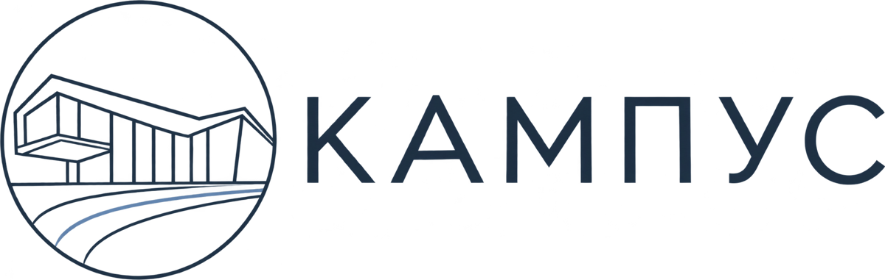</p>

<h1 align="center">Кампус</h1>
<p align="center"><b>Один кабинет для всей учёбы — студенту, преподавателю и деканату</b><br>
Концепт-прототип для MGIMO×AI Challenge, номинация «Вайб-кодинг». Не официальный сервис университета; все люди и данные вымышлены.</p>

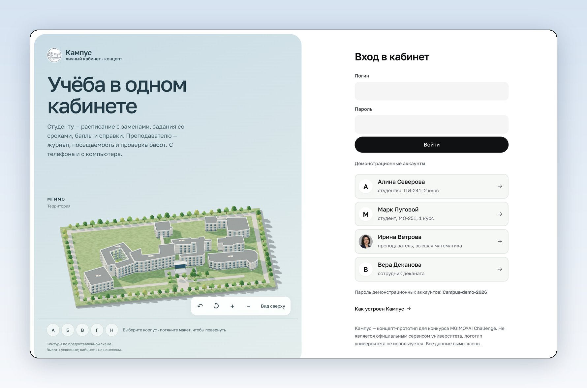

Кампус — личный кабинет университета. Три кабинета связаны между собой: преподаватель выдал задание — оно уже у студента; студент сдал — преподаватель видит сдачу; пропуск в журнале сразу меняет посещаемость в кабинете студента.

**Быстрый старт:** `python3 server.py` → http://127.0.0.1:8080, вход в один клик по карточке демо-аккаунта (пароль `Campus-demo-2026`). Без входа открывается страница [«Как устроен Кампус»](docs/screenshots/about.jpg) со сценарием показа за три минуты.

## Студент

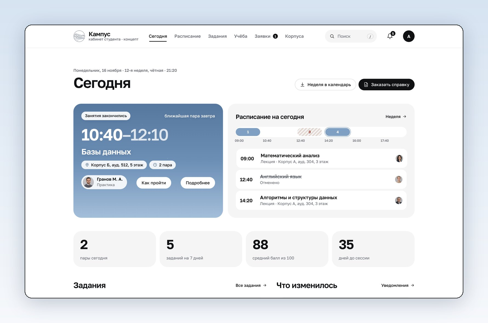

«Сегодня» показывает ближайшую пару с аудиторией и преподавателем, расписание дня, библиотеку с поиском, новости и преподавателей. Уведомления, включая готовые документы и изменения расписания, открываются через колокольчик возле аватара. Задания, оценки и электронный билет доступны в своих разделах.


Задания со сроками, сгруппированные «Просрочено / Сегодня и завтра / На неделе / Позже». Сдача — кружком или со ссылкой на работу; баллы и комментарий преподавателя приходят сюда же.

| Преподаватели и консультации | Запись на консультацию |
| --- | --- |
| 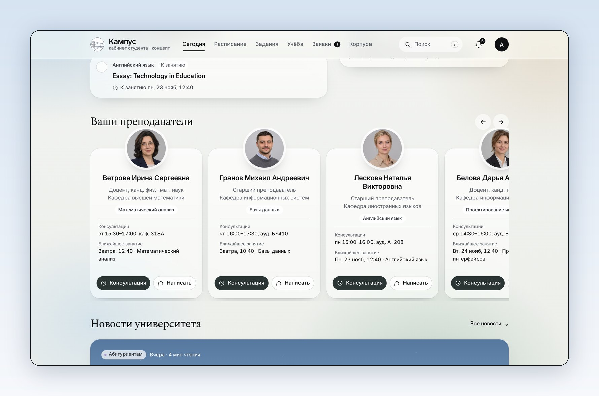 | 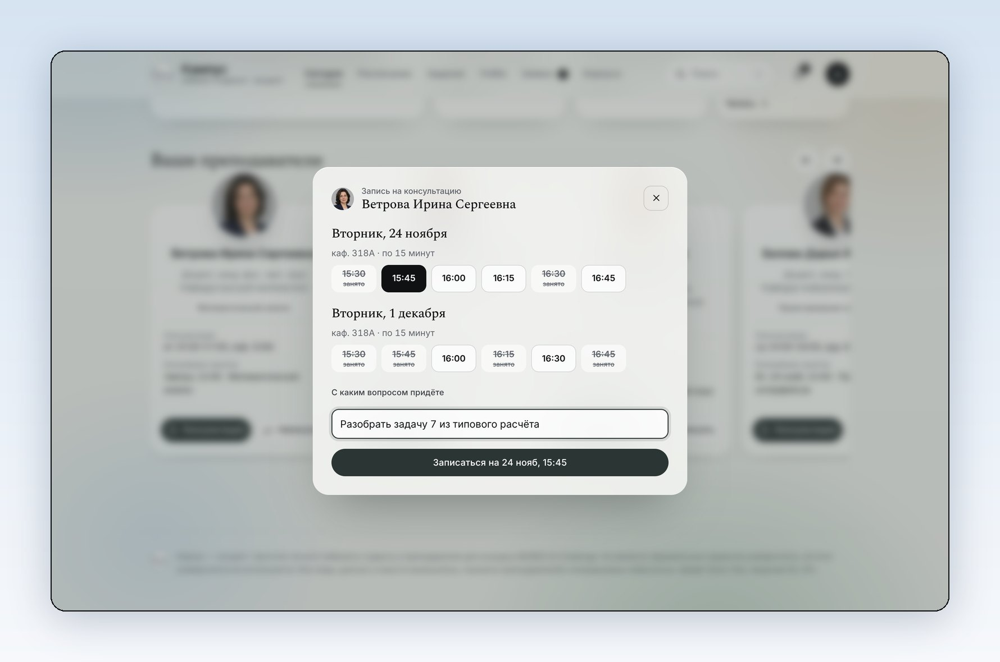 |
| Карточки с портретами, часами приёма и ближайшим занятием | Свободные 15-минутные слоты и вопрос, с которым придёте |

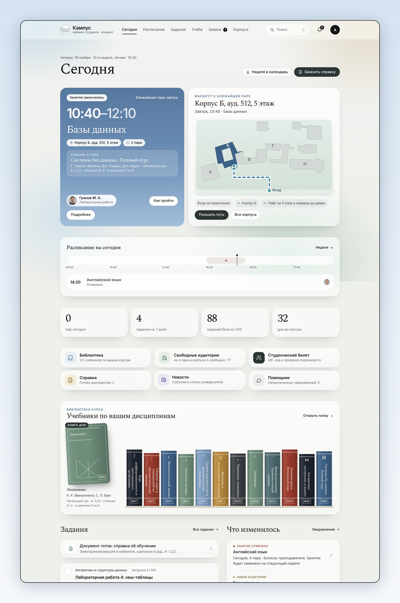

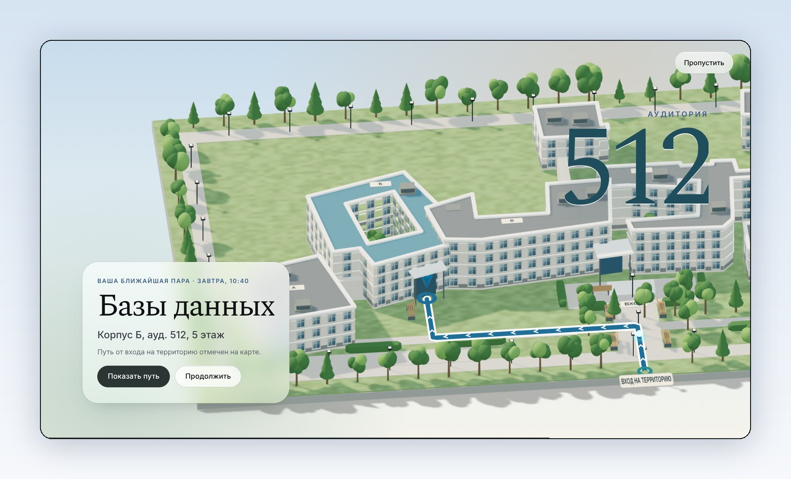

**Главная студента**: ближайшая пара с картой маршрута от входа на территорию до корпуса, учебник к этой паре, расписание на сегодня, четыре быстрых перехода (новости, студенческий, справка, помощник), библиотека, новости и преподаватели. Поиск книг по названию, автору и дисциплине работает и на главной, и на странице «Библиотека курса», сочетается с категориями и наличием; сброс возвращает полную полку. Найденная книга открывается сразу в карточке. Уведомления доступны через колокольчик возле аватара. Свободные аудитории доступны из «Расписания»: выберите день, пару и корпус, затем откройте схему с теми же параметрами. При отсутствии данных о занятости выводится сообщение. Автоматическое вступление после входа отключено.

**Рабочие страницы.** На главной преподавателя — ближайшая пара, работы на проверку, студенты ниже порогов и только занятые слоты консультаций. Заявки деканата раскрываются по одной. Сохранение оценки или ответа сохраняет черновики в остальных строках; фоновое обновление не прерывает заполнение форм и чтение раскрытых разделов. На странице студенческих заявок сначала показана история, каталог открывается через «Новая заявка». На странице корпусов 3D-территория раскрывается отдельно от плана аудитории и маршрута.

**Живые детали интерфейса.** Студенческий билет в «Профиле» — объёмная карта: наклоняется за курсором с бликом и переворачивается, на обороте QR для проверки. В «Учёбе» шкалы по дисциплинам с вкладками «Баллы / Посещаемость / До цели» и порогами 60/75/90. В «Заданиях» список сгруппирован по срокам, полное условие открывается по нажатию. Смена дня и вечера на 3D-макетах проезжает шторкой, а для несуществующих адресов есть страница «Такой аудитории нет». Для показа жюри — «Режим презентации» на экране входа и в «Как устроен Кампус»: 7 слайдов, стрелки и Esc.


«Библиотека курса» (ссылка на странице «Учёба»): бесконечная полка учебников по матанализу, линейной алгебре, вероятностям, экономике, эконометрике и информатике. Выбранная книга выдвигается и поворачивается обложкой; полку листают кликом, стрелками, колёсиком или перетаскиванием. Клик по обложке разворачивает из неё лист с курсом, стеллажом и демонстрационным наличием, а обложка проступает чернильными кляксами. Обложки нарисованы кодом, наличие и стеллажи — демонстрационные.


Объёмная модель территории на three.js: корпуса по контурам кампуса на Вернадского, газоны, дорожки и аллеи, мягкое низкое солнце. Модель вращается, приближается и облетает; выбор корпуса открывает его здание и этажи. Когда выбрана пара или аудитория, на территории подсвечивается путь от входа по дорожкам до двери нужного корпуса — со стрелками направления и меткой цели, а внутри корпуса маршрут продолжается до двери аудитории.

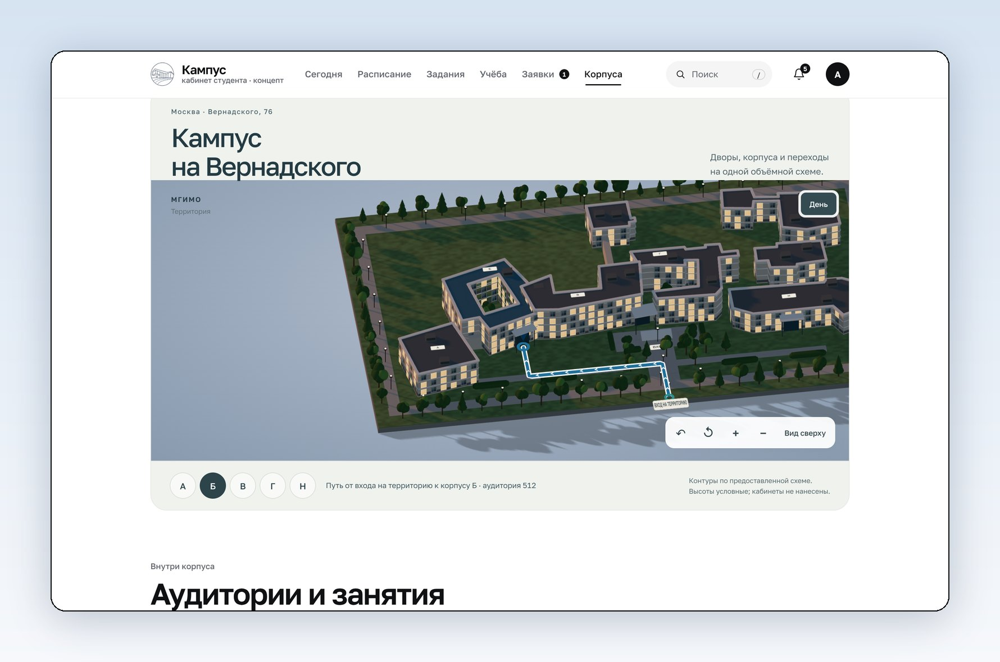

Кнопка «Вечер» включает закатное освещение: светятся окна и фонари вдоль дорожек, путь к аудитории остаётся читаемым.

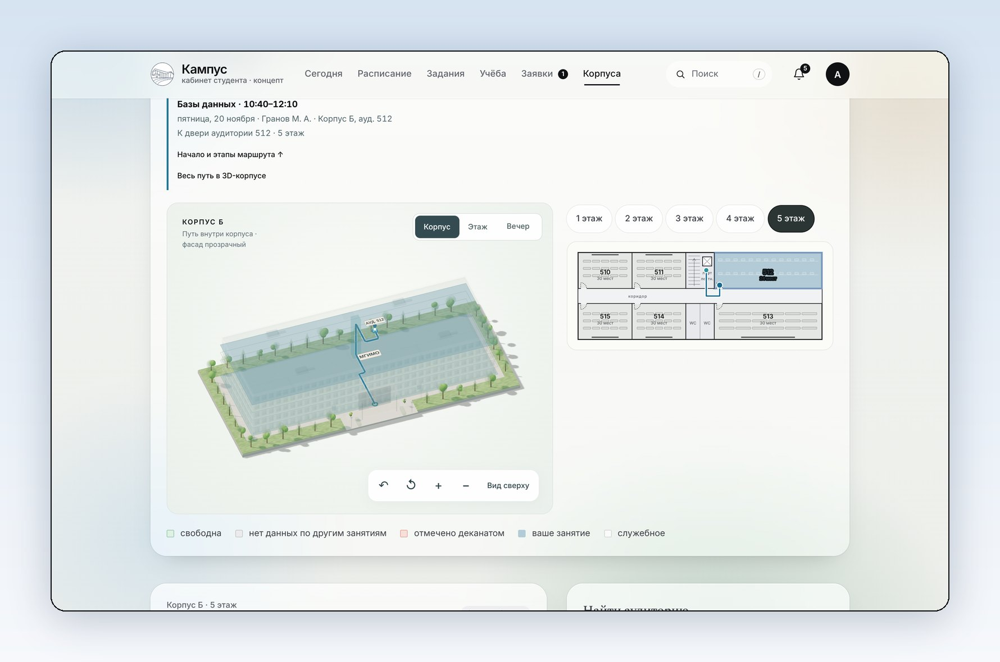

«Весь путь в 3D-корпусе»: фасад становится полупрозрачным, видны контуры этажей. Линия идёт от входа по первому этажу к лифту, поднимается по шахте и ведёт по коридору нужного этажа до двери аудитории. Над целью — метка с номером.

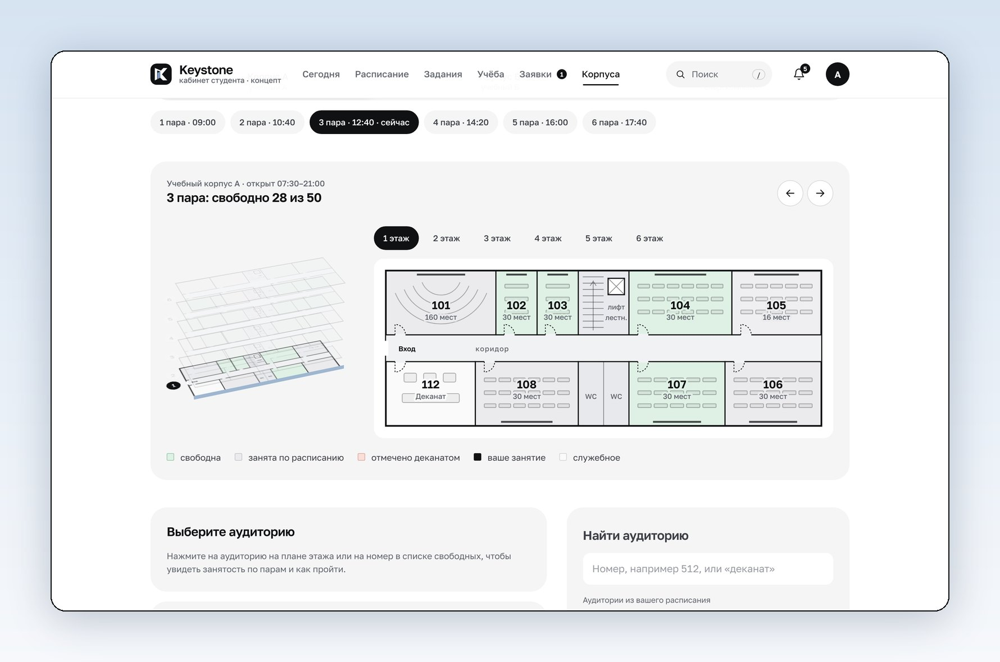

Корпуса — проектные планы этажей: коридоры, двери, лестница и лифт. В 3D видны парты по числу мест, доска, перегородки и амфитеатр в лекционных. Коридоры главного корпуса названы как улицы, и маршрут называет их по порядку. Кнопка «Ближайшая свободная аудитория» найдёт, где подготовиться между парами. Свободные аудитории на выбранную пару, ваше занятие, отметки деканата; этажи стопкой в 3D.

## Преподаватель


Ближайшее занятие и посещаемость, работы на проверку, зона риска (меньше 60 баллов или посещаемость ниже 75%), группы, консультации.


Журнал «студенты × занятия»: отметка меняется кликом, итоги посещаемости и баллов, выгрузка в Excel.

| Проверка работ | Изменение занятия |
| --- | --- |
| 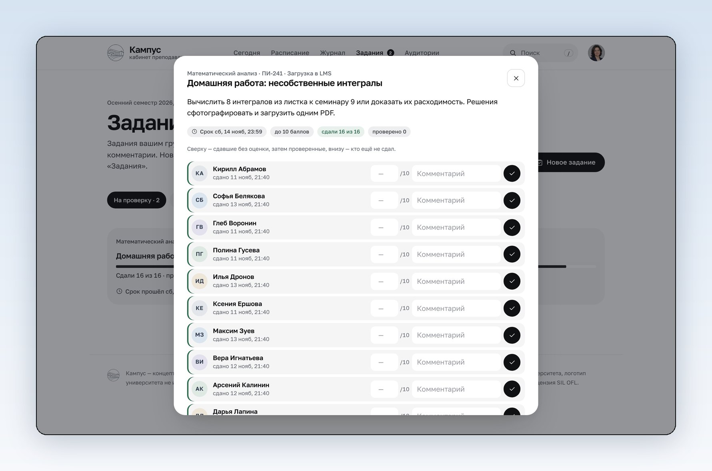 | 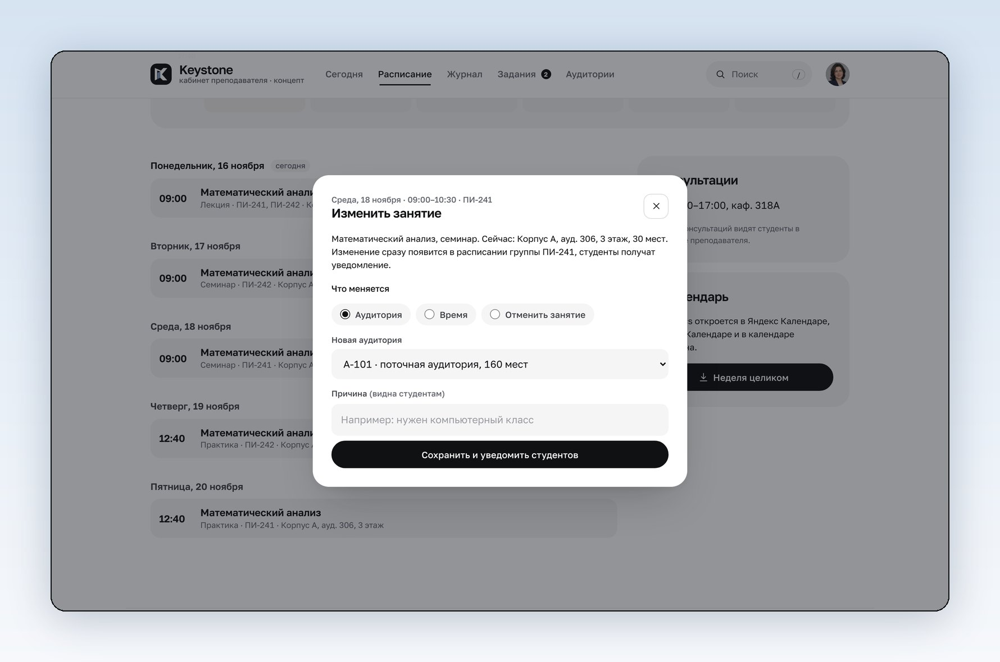 |
| Кто сдал, ссылка на работу, баллы и комментарий в одной строке | Другая аудитория, время или отмена — группа сразу получает уведомление |

## С телефона

Адаптив использует те же страницы, данные, шрифты и стеклянные карточки, что и широкая версия. На узких экранах меняются сетки, отступы, размеры областей нажатия и положение навигации; поиск библиотеки, новости, преподаватели и остальные разделы сохраняются. Поля и диалоги учитывают экранную клавиатуру и безопасные области экрана.


Студент: день и задания. Преподаватель: посещаемость за минуту крупными кнопками и журнал с горизонтальной прокруткой.

## Демо-аккаунты

| Логин | Кто | Что посмотреть |
| --- | --- | --- |
| `alina` | Студентка, ПИ-241 | Сегодня, задания, консультации, справки |
| `mark` | Студент, МО-251 | Другие дисциплины, задолженность, нет допуска |
| `vetrova` | Преподаватель, математический анализ в ПИ-241 и ПИ-242 | Журнал, посещаемость, проверка, изменение занятия |
| `dekanat` | Сотрудник деканата | Заявки, справки с QR, занятость аудиторий |

Пароль всех демо-аккаунтов — `Campus-demo-2026`.

Подробнее: [архитектура](docs/architecture.md) · [как создавался проект](docs/process.md) · [исследование порталов](docs/benchmark-portals.md)

## Оформление

Стиль — спокойный и деловой: белый фон, мягкие серые карточки без рамок, чёрные кнопки-пилюли. Единственный цвет — приглушённое небо (`#7898bd` → `#b6cfe4`) с редкими звёздами; оно занимает один главный блок страницы: «Сейчас» на главной, первую новость, электронный билет, экран входа. Один шрифт — Golos Text (SIL OFL, `public/fonts`). Токены — в `public/css/tokens.css`.

Разделы: «Сегодня» (текущая или следующая пара, расписание дня, задания на неделю, изменения, преподаватели, новости), «Расписание», «Задания» (домашние задания и работы из LMS со сроками, группировка по срокам, отметка «Сделано», проверенные работы с баллами), «Учёба» (баллы, допуск, карусель преподавателей, график сессии), «Заявки», «Корпуса».

«Корпуса» — планы этажей: коридор, аудитории разной ширины по вместимости, двери с дугой открывания, лестница, лифт, туалеты, вход и переход между корпусами; внутри аудиторий мебель по типу (ряды амфитеатра в лекционных, парты, компьютерные столы, разметка спортзала). Слева — этажи стопкой в 3D, выбранный этаж приподнят, верхние прозрачные; справа — крупный план этажа, аудитории нажимаются. Новости университета (рубрики «Университет», «Образование», «Абитуриентам», «Проекты») вымышлены и приходят с сервера (`campus_data.NEWS`). Портреты преподавателей — вымышленные люди, сгенерированные в ChatGPT по промптам из `docs/portraits-prompts.md`; лежат в `public/assets/people/<ключ>.webp` (320×320, webp). Если портрета нет, показываются инициалы. Знак «Кампуса» — корпус в круге; команда сгенерировала его в ChatGPT (`public/logo-full.png`, эмблема — `public/mark.png`).

## Что взято у лучших вузовских сервисов

| Возможность | Чей опыт | Как сделано здесь |
| --- | --- | --- |
| Экран «Сегодня»: что идёт, что изменилось, что сделать | MIT Student Dashboard | Карточка текущей пары, стикеры изменений «было → стало», список дел |
| Свободные аудитории | ВШЭ, NUSMods, Цинхуа | 3D-схема этажей по парам, занятость по расписанию и отметкам деканата |
| Электронная справка с проверкой | Фудань (подписанный PDF и верификатор) | Документ с QR, публичная страница проверки, фамилия скрыта, отзыв при отклонении |
| Цифровой студенческий билет | ИТМО, 539-ФЗ | Билет с QR и проверкой статуса обучения |
| Поиск-действие | NavigaTUM | Поиск по `/` или Ctrl+K: занятия, аудитории, преподаватели, документы |
| Статус заявки как доставка | Госуслуги | Этапы, срок по каждому документу, история с автором |
| Перевод баллов в оценку | UniNow | «До отлично ещё N», «до зачёта автоматом ещё N», порог допуска |
| Лента семестра | MIT | Недели семестра и сессия одной полосой |

Чего избегали: уведомлений без приоритета, мобильной версии «только посмотреть», непонятных статусов, социального сравнения оценок.

## Кабинет деканата: занятость аудиторий

Сотрудник открывает ту же 3D-схему, выбирает пару, нажимает на аудиторию и отмечает её занятой или свободной на пару или на весь день, с причиной («ремонт», «конференция»). Студенты видят отметку сразу. Отметка действует на текущий день (в воскресенье — на понедельник) и снимается одной кнопкой.

## Локальный запуск

Нужен Python 3.11 или новее. Установка пакетов не требуется.

```sh
python3 server.py
```

Откройте [кабинет](http://127.0.0.1:8080). На странице входа есть кнопки для быстрого входа, пароль всех демо-аккаунтов — `Campus-demo-2026`.

| Логин | Роль | Что видно |
| --- | --- | --- |
| `alina` | Студентка, ПИ-241 | Своё расписание, оценки, заявки и уведомления |
| `mark` | Студент, МО-251 | Свои данные, другие дисциплины и заявки |
| `vetrova` | Преподаватель, математический анализ в ПИ-241 и ПИ-242 | Журнал, посещаемость, задания и оценки своих групп, сообщения группам |
| `dekanat` | Сотрудник деканата | Очередь заявок всех студентов, смена статусов, публикация объявлений |
 Общий пароль для демо — `Campus-demo-2026`. Он предназначен для общедоступных тестовых аккаунтов. В SQLite хранятся хеши паролей с уникальными солями. Заявки и отметки о прочтении сохраняются в базе между входами.

## Помощник

По умолчанию включён справочный режим. Он отвечает по расписанию, оценкам, срокам и справкам из данных текущего студента. Для свободного диалога задайте три переменные окружения на сервере.

| Переменная | Значение |
| --- | --- |
| `CAMPUS_AI_URL` | Полный HTTPS URL доверенного сервиса с API формата Chat Completions |
| `CAMPUS_AI_MODEL` | Имя модели |
| `CAMPUS_AI_KEY` | Ключ провайдера |

Модель получает вопрос, демонстрационные учебные сведения, расписание и уведомления вошедшего студента. Она не изменяет записи. Прототип рассчитан на вымышленные данные.

## Размещение

Приложение запускается на сервере с Python и постоянным диском. Для развертывания укажите `HOST`, `PORT` и `CAMPUS_DB` для пути к SQLite. Публичный вход требует HTTPS на прокси и `CAMPUS_SECURE_COOKIE=1`. `server.py` — сервер для демонстрации, масштабирование и боевой режим потребуют отдельной настройки.

Для Docker-хоста с TLS reverse proxy подготовлен Compose-файл: он хранит SQLite в named volume и открывает порт приложения только на `127.0.0.1`.

```sh
docker compose up --build -d
```

Домен и HTTPS настраиваются на хосте перед приложением. Не публикуйте порт 8080 напрямую в интернет. Для требования доступности из России проверьте домен с нескольких российских сетей и оставьте сервер и persistent volume активными до конца конкурса. Публичная ссылка на сайт в этом репозитории пока не настроена. Российский облачный VM допускает подключение постоянных дисков, но стоит денег; перед запуском проверьте текущий тариф.

[Как создавался прототип](docs/process.md) · [Исследовательские решения](docs/research.md)

## Расписание и аудитории

Модель данных в `campus_data.py`: звонки по парам (6 пар по 90 минут, обеденный перерыв 30 минут), учебные недели с циклом 16 недель и чётностью, подгруппы, онлайн-занятия, корпуса и этажи, справочник аудиторий, преподаватели с кафедрой и консультациями. Оперативные изменения четырёх видов (новая аудитория, перенос времени, отмена, замена преподавателя) показываются как «было → стало» с причиной и временем публикации. Из карточки занятия можно добавить его в календарь (`.ics`, часовой пояс Europe/Moscow). У Марка есть дисциплина без допуска (меньше 60 баллов) — на ней видно, как кабинет подсвечивает риск.

Структура фронтенда без сборки: `public/js/main.js` (маршруты, события), `student.js`, `teacher.js` и `staff.js` (экраны), `util.js` (даты по Москве, календарь), `public/css/*.css`. Строгая политика CSP: скрипты и стили только свои, без inline.

## Кабинет деканата и путь заявки

Заявка проходит статусы «Принята» → «В работе» → «Готова» → «Выдана» (или «Отклонена»). Сотрудник деканата меняет статус и оставляет комментарий, например где забрать справку. Студент видит текущий статус, последний комментарий и полную историю с датой и автором каждого шага. Объявления деканата можно адресовать всем студентам или одной группе: студенты другой группы их не видят.

Студенческий аккаунт не может открыть API деканата (403) и чужую заявку по прямому адресу (404). После пяти неудачных попыток входа за 15 минут вход для пары «адрес + логин» временно блокируется.

## Проверки

```sh
python3 -m unittest discover -s tests -v
```

Тесты поднимают сервер с временной базой и проверяют хеширование паролей, разделение данных студентов, недоступность чужих заявок и API деканата, путь заявки от студента к сотруднику и обратно, адресные объявления, ограничение попыток входа, отклонение межсайтовых запросов, выход и отсутствие секретов во фронтенде.
